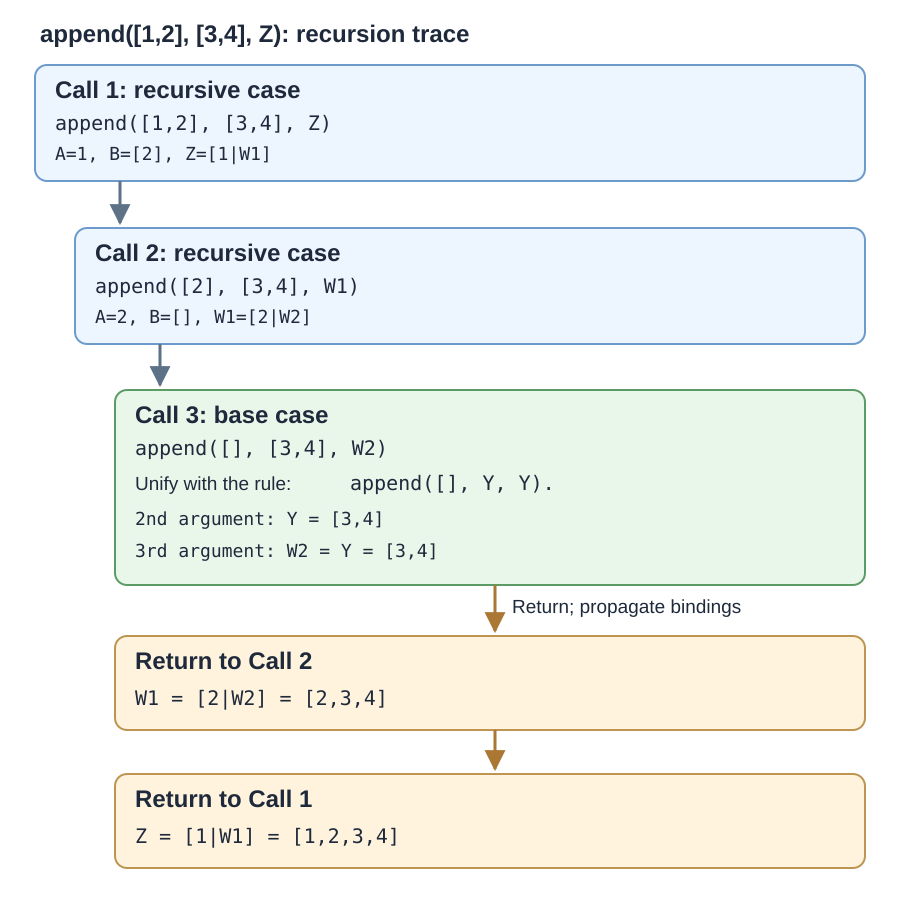

# Recursive append and backward queries

Part 2 append example; also extends `Unification append(X,Y,Z)_rev.docx`.

Load from the repository root in SWI-Prolog:

```prolog
?- ['CIS774_Prolog_Part2_Examples/append-lists.pl'].
```

Run these queries:

```prolog
?- append_demo([], [1,2,3], Z).
?- append_demo([1,2], [3,4], Z).
?- append_demo(X, Y, [1,2]).
```

The second query produces `Z = [1,2,3,4]`. The third enumerates splits: `([], [1,2])`, `([1], [2])`, `([1,2], [])`; press `;` for more.

## Step-by-step recursion

1. `append_demo([1,2],[3,4],Z)` matches `[A|B]=[1,2]`, so `A=1`, `B=[2]`, `Z=[1|W1]`.
2. `append_demo([2],[3,4],W1)` sets `A=2`, `B=[]`, `W1=[2|W2]`.
3. Base case `append_demo([],[3,4],W2)` gives `W2=[3,4]`.
4. Substitute upward: `W1=[2,3,4]`, then `Z=[1,2,3,4]`.



### Why does the base case give `W2 = [3,4]`?

The base case is:

```prolog
append_demo([], Y, Y).
```

The last recursive call is:

```prolog
append_demo([], [3,4], W2).
```

Unify the corresponding arguments:

| Argument | Base-case rule | Recursive call | Result |
| --- | --- | --- | --- |
| First | `[]` | `[]` | Matches |
| Second | `Y` | `[3,4]` | `Y = [3,4]` |
| Third | `Y` | `W2` | `W2 = Y = [3,4]` |

The **same variable `Y` appears in both the second and third arguments** of the base-case rule. Therefore, when `Y` becomes bound to `[3,4]`, the third argument `W2` must be `[3,4]` too.

Now the bindings propagate back through the recursive calls:

```text
W2 = [3,4]
W1 = [2|W2] = [2,3,4]
Z  = [1|W1] = [1,2,3,4]
```

This is **returning from recursion and propagating bindings**, not backtracking to try an alternative clause.

Note: `W1` and `W2` are separate variables for separate recursive calls. This makes the return substitutions clearer than reusing `W` in each frame.
