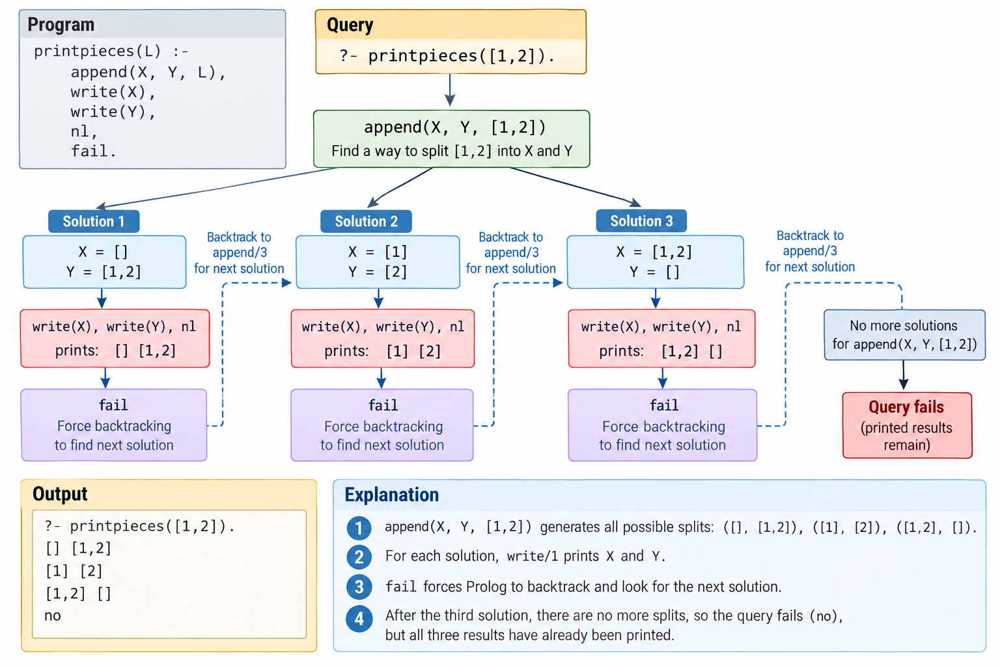

# Forced Backtracking with `fail`: `printpieces`

## Learning objectives

After working through this example, you should be able to explain how `append/3` can split a list, why `fail` forces backtracking, and why a second `printpieces(_)` clause changes the final query result.

## Prolog program

The repository's `printpieces.pl` contains **two clauses**:

```prolog
printpieces(L) :-
    append(X, Y, L),
    write(X), write(' '), write(Y), nl,
    fail.

printpieces(_).
```

The first clause prints every split. The second clause succeeds after the first clause has exhausted its alternatives.

| Expression | Purpose |
| --- | --- |
| `append(X, Y, L)` | Generate a pair of lists `X` and `Y` that concatenate to `L`. |
| `write(X)`, `write(Y)` | Print the two parts. |
| `nl` | Start a new output line. |
| `fail` | Deliberately fail, making Prolog backtrack to look for another split. |
| `printpieces(_)` | Succeed once no more splits can be generated. `_` is an anonymous variable. |

## Run in GitHub Codespaces

From the repository root, start SWI-Prolog:

```bash
swipl
```

At the Prolog prompt, load the file using its folder path:

```prolog
?- ['CIS774_Prolog_Part2_Examples/printpieces.pl'].
?- printpieces([1,2]).
```

Expected output (spacing may vary):

```text
[] [1,2]
[1] [2]
[1,2] []
true.
```

The `true.` at the end is due to the **second clause**, not because `fail` succeeds.

## Backtracking trace diagram



*Figure 1. Forced backtracking for `printpieces([1,2])`. The diagram shows the first clause alone, which ultimately fails; the repository program also has a second clause that succeeds.*

### Accessible text description of Figure 1

1. The query `printpieces([1,2])` enters the first clause and calls `append(X, Y, [1,2])`.
2. **First split:** `X = []`, `Y = [1,2]`. The program prints `[] [1,2]`, then `fail` triggers backtracking.
3. **Second split:** `X = [1]`, `Y = [2]`. The program prints `[1] [2]`, then `fail` triggers backtracking.
4. **Third split:** `X = [1,2]`, `Y = []`. The program prints `[1,2] []`, then `fail` triggers backtracking.
5. `append/3` has no further splits. The first clause fails after producing the three printed lines.
6. **In the repository's two-clause program**, Prolog then tries `printpieces(_)`, which succeeds, so the overall query reports `true.`

The lines printed by `write/1` remain visible even though `fail` causes the first clause to fail.

## Why is `append/3` used backward?

A familiar forward query concatenates two known lists:

```prolog
?- append([1,2], [3,4], Result).
Result = [1,2,3,4].
```

In `printpieces`, the **result list is already known**, but the two parts are variables:

```prolog
?- append(X, Y, [1,2]).
```

Prolog can enumerate the three splits. At the interactive prompt, type `;` to request the next one:

```text
X = [], Y = [1,2] ;
X = [1], Y = [2] ;
X = [1,2], Y = [].
```

Inside `printpieces/1`, the `fail` predicate requests further alternatives automatically instead of waiting for the user to type `;`.

## Compare the one-clause and two-clause versions

**One clause (as depicted in the figure):**

```prolog
printpieces(L) :-
    append(X, Y, L),
    write(X), write(' '), write(Y), nl,
    fail.
```

After printing all three splits for `[1,2]`, this version reports `false.` (or `no` in some Prolog systems), because every path through the only clause reaches `fail`.

**Two clauses (the repository version):**

```prolog
printpieces(L) :-
    append(X, Y, L),
    write(X), write(' '), write(Y), nl,
    fail.
printpieces(_).
```

After printing all splits, the second clause succeeds, so the query reports `true.`. The second clause does not print anything.

## Try a longer list

```prolog
?- printpieces([1,2,3]).
```

Expected output:

```text
[] [1,2,3]
[1] [2,3]
[1,2] [3]
[1,2,3] []
true.
```

For a list of length `n`, there are `n + 1` ways to split it into a prefix and a suffix, including an empty prefix or empty suffix.

## Check your understanding

1. Why does `append(X, Y, [1,2])` produce three different solutions?
2. What happens if you remove `fail` from the first clause?
3. Why does the one-clause version finish with `false.` even though it prints three valid splits?
4. What purpose does `printpieces(_).` serve in the two-clause version?

**Key distinction:** `fail` forces Prolog to search for another solution; it does not erase anything already printed.
