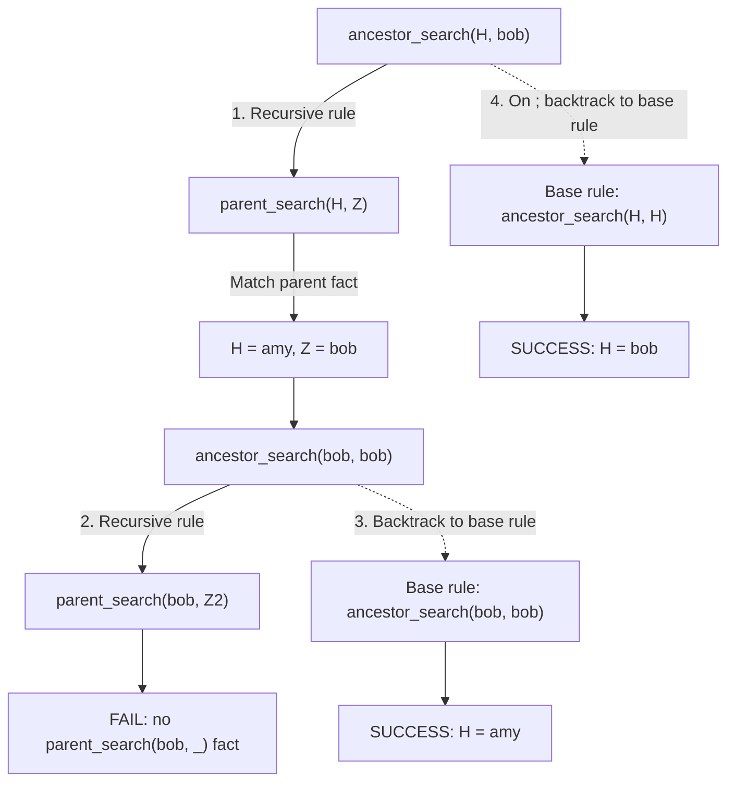

# Depth-first search, backtracking, and clause order

Based on *Prolog's Search Mechanism* and the Part 2 slides.

## Prolog program

See [search-backtracking.pl](search-backtracking.pl):

```prolog
ancestor_search(X, Y) :- parent_search(X, Z), ancestor_search(Z, Y).
ancestor_search(X, X).
parent_search(amy, bob).
```

Load the program in SWI-Prolog and run:

```prolog
?- ancestor_search(H, bob).
```

Press `;` to request the next answer. Prolog returns `H = amy` and then `H = bob`.

## Search-tree graph

The graph shows the order in which Prolog tries the recursive rule and then backtracks to the base rule. The dashed arrow represents the alternative branch explored only after backtracking.



### Accessible text description

The root query is `ancestor_search(H, bob)`. Prolog first chooses the recursive clause, which requires `parent_search(H, Z)`. The only parent fact binds `H = amy` and `Z = bob`. The next recursive goal is `ancestor_search(bob, bob)`. Trying its recursive clause fails because there is no fact `parent_search(bob, _)`. Prolog backtracks and uses the base clause `ancestor_search(X, X)`, which succeeds for `bob`; this yields the first answer, `H = amy`. When the user enters `;`, Prolog eventually backtracks to the original goal and uses its base clause, producing the second answer, `H = bob`.

## Step-by-step execution trace

| Step | Goal or action | Result |
|---|---|---|
| 1 | `ancestor_search(H, bob)` | Try recursive clause first |
| 2 | `parent_search(H, Z)` | Bind `H = amy`, `Z = bob` |
| 3 | `ancestor_search(bob, bob)` | Try recursive clause first |
| 4 | `parent_search(bob, Z2)` | Fails: no matching parent fact |
| 5 | Backtrack to `ancestor_search(X, X)` for `(bob, bob)` | Succeeds; first answer `H = amy` |
| 6 | User types `;` | Request another answer |
| 7 | Backtrack to original `ancestor_search(H, bob)` and try its base clause | Second answer `H = bob` |

## What students should notice

- **Depth-first search:** Prolog follows the recursive branch before trying the base clause.
- **Clause order:** Prolog tries clauses in the order they appear in the program.
- **Backtracking:** A failed goal causes Prolog to return to the most recent available choice point.
- **Multiple answers:** Typing `;` asks Prolog to continue searching for another solution.
- **Base case:** `ancestor_search(X, X)` permits a person to be their own ancestor under this program's definition; it is a reflexive relation, unlike the everyday strict meaning of *ancestor*.

**Caution:** Reordering recursive clauses or introducing unguarded left recursion can cause nontermination with Prolog's depth-first search.

## Practice questions

1. Why does `parent_search(bob, Z2)` fail?
2. Which clause produces the first answer, `H = amy`, and which produces the second, `H = bob`?
3. Why does Prolog not immediately try the base clause at the root?
4. What does entering `;` mean at the Prolog prompt?
